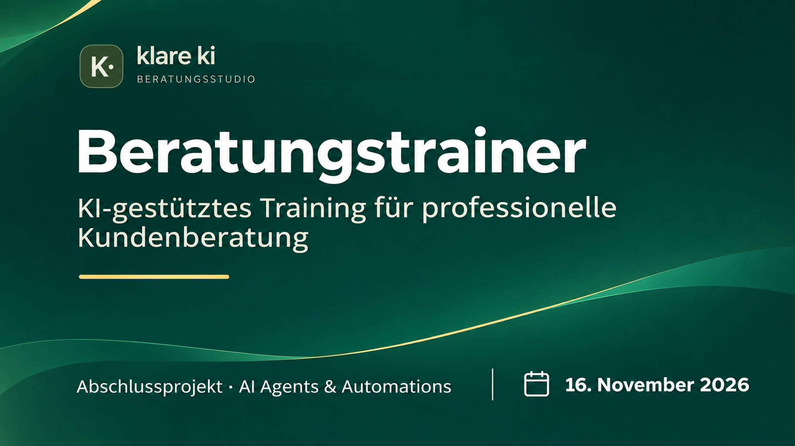
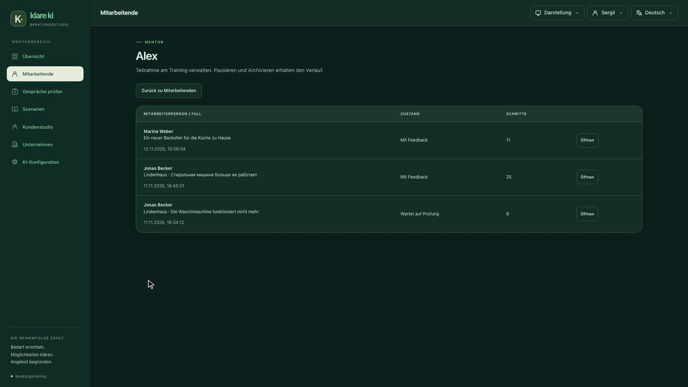
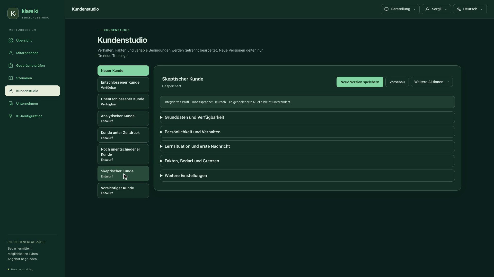
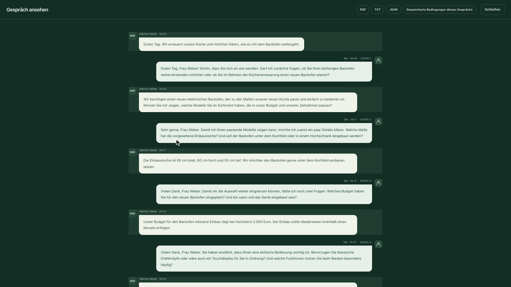
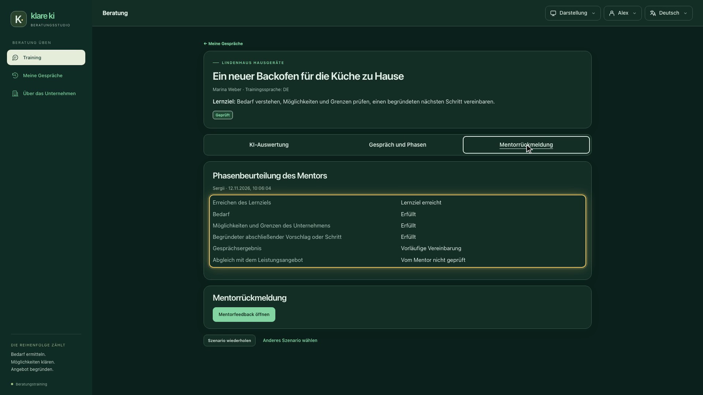

# Klare KI Beratungstrainer

Ein lokal ausführbarer MVP für strukturierte Kundenberatung: Mitarbeitende üben mit einem KI-Kunden, reflektieren ihre Fragen und erhalten eine eigenständige Beurteilung durch den Mentor. **Code, Produktansichten und Demonstration sind veröffentlicht; eine öffentliche Web-Anwendung wird nicht betrieben.**

## Demo ansehen

**[▶ Finale Demonstration](https://github.com/klarekipro/Beratungsgespr-ch-Trainer/releases/download/v0.17.0/beratungstrainer_final_sergi2_music_pacing_v5.mp4)**

Vollständige Produktdemonstration. Der Link öffnet die MP4-Datei direkt im Browser-Player — keine Anmeldung erforderlich.

## Kurzvideo · 60 Sekunden

**[▶ Promo-Video · 60 s · mit Untertiteln](https://github.com/klarekipro/Beratungsgespr-ch-Trainer/releases/download/v0.17.0/beratungstrainer_promo_P05_de_untertitel.mp4)**

Kompakte Vorstellung. Für Präsentationen mit Ton steht zusätzlich eine [Fassung ohne feste Untertitel](https://github.com/klarekipro/Beratungsgespr-ch-Trainer/releases/download/v0.17.0/beratungstrainer_promo_P05_de_ohne_untertitel.mp4) sowie eine [externe SRT-Datei](https://github.com/klarekipro/Beratungsgespr-ch-Trainer/releases/download/v0.17.0/beratungstrainer_promo_P05_de.srt) bereit. Mehr erfahren: https://klare-ki.de

Vorschaubild, frühere Fassungen und weitere Materialien

**Film ohne Hintergrundmusik (fix1, 05:08.23)** — dieselbe Videoabfolge und dieselbe Sprachausgabe, nur ohne Musik:

https://github.com/user-attachments/assets/5b0ce12f-7d88-4dd9-83ae-2ece50a4428a

[▶ fix1 im Browser öffnen](https://github.com/user-attachments/assets/5b0ce12f-7d88-4dd9-83ae-2ece50a4428a) · [Original-MP4 herunterladen](https://github.com/klarekipro/Beratungsgespr-ch-Trainer/releases/download/v0.15.3/beratungstrainer_final_sergi2_fix1.mp4)

[Erste Filmfassung (rev01g)](https://github.com/klarekipro/Beratungsgespr-ch-Trainer/releases/download/v0.15.3/beratungstrainer_preview_rev01g.mp4) · [Musikversion V2](https://github.com/klarekipro/Beratungsgespr-ch-Trainer/releases/download/v0.16.0/beratungstrainer_final_sergi2_music_v2.mp4) · [Release v0.17.0 (V5 + Promo)](https://github.com/klarekipro/Beratungsgespr-ch-Trainer/releases/tag/v0.17.0) · [Release v0.16.0](https://github.com/klarekipro/Beratungsgespr-ch-Trainer/releases/tag/v0.16.0) · [Release v0.15.3](https://github.com/klarekipro/Beratungsgespr-ch-Trainer/releases/tag/v0.15.3) · [Produktionsmaterial und Re-Edit](VIDEO_PRODUCTION.md)

## Erst verstehen, dann beraten

Ein Produkt zu kennen reicht für gute Beratung nicht aus. Entscheidend ist, die richtigen Fragen zu stellen: Was braucht die Kundin oder der Kunde tatsächlich? Welche Bedingungen sind bereits geklärt? Was kann das Unternehmen leisten, und welche Zusagen wären unbegründet?

Der Beratungstrainer bietet einen geschützten Übungsablauf mit einem KI-Kunden und einer menschlichen Mentorin oder einem Mentor. Mitarbeitende können Gespräche führen, ihre Fragen und Vorschläge reflektieren und gezieltes Feedback erhalten. Auch ein Gespräch ohne Kauf kann fachlich sinnvoll abgeschlossen sein.

## Drei Schritte einer strukturierten Beratung

| Schritt | Was trainiert wird |
|---|---|
| **Bedarf klären** | Anliegen, Rahmenbedingungen, Prioritäten und offene Fragen ermitteln. |
| **Möglichkeiten erklären** | Leistungen und Grenzen des Unternehmens anhand vorhandener Informationen verständlich darstellen. |
| **Nächsten Schritt begründen** | Ein passendes Angebot oder eine nachvollziehbare nächste Handlung vorschlagen, ohne einen Abschluss zu erzwingen. |

## Mitarbeitende, KI-Kunde und Mentor

Mitarbeitende wählen ein Szenario und ein Kundenprofil. Der KI-Kunde erhält die für seine Rolle freigegebenen Informationen; interner Katalog und Bewertungsraster werden ihm nicht als Wissen mitgegeben. Das Gespräch wird mit den zugehörigen Szenario-, Profil- und Unternehmensständen gespeichert.

Nach dem Gespräch unterstützt eine **vorläufige KI-Auswertung** die Reflexion. Abschluss, Einreichung zur Prüfung und kommerzielles Ergebnis bleiben getrennte Zustände. Der Mentor liest Gespräch und Belege, bewertet die Beratung und veröffentlicht ausdrücklich das Feedback für die lernende Person. Seine private KI-Auswertung wird dabei nicht mitveröffentlicht. Längere Dokumente öffnen in eigenen Ansichten; PDF-/TXT-Exporte benötigen keine neuen KI-Aufrufe.

## Mehrsprachigkeit und Persona Studio

Die Oberfläche unterstützt **Deutsch, Englisch und Russisch**. Oberflächensprache, Trainingssprache und Sprache selbst verfasster Inhalte sind getrennt. Historische Gespräche werden nicht nachträglich übersetzt oder mit neuen Materialien überschrieben.

Im Persona Studio lassen sich Kundenprofile bearbeiten und versionieren. Sieben unveränderte integrierte Profile besitzen abgestimmte DE-/EN-/RU-Darstellungen. Eigene oder veränderte Texte werden nicht ungefragt automatisch übersetzt.

Das fiktive Unternehmen **Lindenhaus** bildet den Trainingskontext: 18 Produkte, 9 Dienstleistungen sowie Preise, Bedingungen, Kontaktangaben und Beratungszeiten. Die `.example`-Kontakte sind keine echten Kontaktmöglichkeiten.

## Bewertung und Zertifikate

Die KI liefert Hinweise und Belege, keine endgültige Lernentscheidung. Die strukturierte Beurteilung und das veröffentlichte Feedback liegen beim Mentor. Ein Zertifikat wird separat mit ausdrücklicher Bestätigung ausgestellt. Empfänger- und Ausstellername sind vor der Ausstellung bearbeitbar; die ausgestellte Fassung bewahrt Namen und PDF als unveränderlichen Stand. Das Zertifikat dokumentiert die Beurteilung innerhalb dieses Trainings und ist keine staatlich anerkannte Qualifikation.

## Einblicke in die Anwendung

Vier Originalansichten aus der freigegebenen Produktdemonstration. Ein Klick öffnet die jeweilige Aufnahme in voller Auflösung.

| Mitarbeitende und Trainingsverlauf | Persona Studio / Kundenstudio |
|---|---|
|  |  |
| **Beratungsgespräch** | **Beurteilung durch den Mentor** |
|  |  |

## Technischer Aufbau

| Bereich | Umsetzung |
|---|---|
| Backend | Python, FastAPI, Pydantic, Uvicorn |
| Speicherung | SQLite, versionierte Lernobjekte, gesprächsspezifische Snapshots |
| Frontend | HTML, CSS und JavaScript ohne erforderlichen Frontend-Build |
| KI | serverseitige OpenAI-Anbindung für Kundenrolle, Auswertungen und Spracherkennung; Aufrufe können Kosten verursachen |
| Zugriff | getrennte Mitarbeiter-/Mentor-Bereiche, Rollenprüfung, Argon2-Passworthashes |
| Dokumente | PDF-Erstellung mit ReportLab und Unicode-Schriften |

[Architektur](docs/architecture/SYSTEM_ARCHITECTURE.md) · [Backend](backend/app/dashboard/) · [Frontend](frontend/) · [fokussierte Tests](tests/dashboard/)

## Stand des MVP

Version **0.15.3-persona-localization**. Der vollständige deutsche Ablauf mit Mentor-Feedback und Zertifikatszustellung wurde vom Projekteigentümer erfolgreich abgenommen (**E2E-01 PASS**).

[Lokale Installation und Betrieb](docs/LOCAL_OPERATIONS_RU.md) · [Release Notes](docs/releases/v0.15.3.md)

## Mögliche nächste Schritte

Gezieltere KI-Belege und Coaching-Hinweise, ein natürlicherer Gesprächsabschluss, weiterführende Administrationsabläufe sowie eine breitere Browser-, Mikrofon- und Druckprüfung sind mögliche Erweiterungen. Ein späterer begrenzter Pilotbetrieb benötigt eine eigene Betriebs- und Sicherheitsvorbereitung. Diese Punkte sind **nicht Bestandteil der abgenommenen MVP-Funktionalität**.

## Filme und Produktionsmaterial

- [**Finale Demonstration · 05:24**](https://github.com/klarekipro/Beratungsgespr-ch-Trainer/releases/download/v0.17.0/beratungstrainer_final_sergi2_music_pacing_v5.mp4) — aktuelle Fassung (V5)
- [**Kurzvideo · 60 s · mit Untertiteln**](https://github.com/klarekipro/Beratungsgespr-ch-Trainer/releases/download/v0.17.0/beratungstrainer_promo_P05_de_untertitel.mp4) · [ohne Untertitel](https://github.com/klarekipro/Beratungsgespr-ch-Trainer/releases/download/v0.17.0/beratungstrainer_promo_P05_de_ohne_untertitel.mp4) · [SRT](https://github.com/klarekipro/Beratungsgespr-ch-Trainer/releases/download/v0.17.0/beratungstrainer_promo_P05_de.srt)
- [Musikversion V2 · 05:11](https://github.com/klarekipro/Beratungsgespr-ch-Trainer/releases/download/v0.16.0/beratungstrainer_final_sergi2_music_v2.mp4) — vorherige Musik-Fassung
- [Fassung ohne Musik · 05:08](https://github.com/klarekipro/Beratungsgespr-ch-Trainer/releases/download/v0.15.3/beratungstrainer_final_sergi2_fix1.mp4) — identische Sprachausgabe
- [Erste Fassung · 05:01](https://github.com/klarekipro/Beratungsgespr-ch-Trainer/releases/download/v0.15.3/beratungstrainer_preview_rev01g.mp4)
- [Produktionsarchiv ZIP](https://github.com/klarekipro/Beratungsgespr-ch-Trainer/releases/download/v0.15.3/BERATUNGSTRAINER_FINAL_ARCHIVE.zip) · [Clean Masters Manifest](https://github.com/klarekipro/Beratungsgespr-ch-Trainer/releases/download/v0.17.0/CLEAN_MASTERS_MANIFEST.md)
- [SHA-256 v0.17.0](https://github.com/klarekipro/Beratungsgespr-ch-Trainer/releases/download/v0.17.0/v0.17.0-SHA256SUMS.txt) · [SHA-256 v0.16.0](https://github.com/klarekipro/Beratungsgespr-ch-Trainer/releases/download/v0.16.0/v0.16.0-SHA256SUMS.txt) · [SHA-256 v0.15.3](docs/releases/v0.15.3-SHA256SUMS.txt) · [Wiederverwendung](VIDEO_PRODUCTION.md)

Die Originaldateien von v0.15.3 (fix1, rev01g, Archiv) bleiben unverändert. Die enthaltenen Demonstrationskonten, Gespräche, Bewertungen und Zertifikatsdaten sind vom Projekteigentümer zur öffentlichen Darstellung freigegeben.
