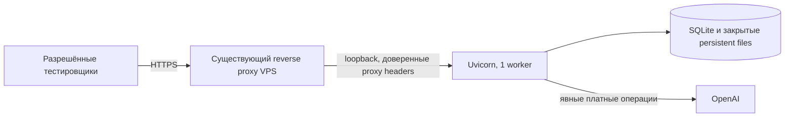

# A35 — предварительная оценка VPS, только документация

11.11.2026, Europe/Berlin. Основание: чтение текущего кода и локальной установки0.15.1; конфигурация/ресурсы/домен существующего Hetzner VPS неизвестны. Подключений к VPS, деплоя, настройки DNS/firewall/reverse proxy, открытия локального8100 наружу не выполнялось.

**Вывод:** ограниченный пилот на одном VPS технически представим, но текущая macOS-установка не является готовым проверенным Linux-deployment. Публичное открытие требует отдельной задачи и разрешения; локальная немецкая приёмка не равна внешней security-приёмке.

## Имеющиеся зависимости

| Компонент | Факт текущей установки / требование будущего пилота |
|---|---|
| Процесс | Python3.14.7; FastAPI0.141.1 / Uvicorn0.52.1; одна Uvicorn worker, API + static frontend без Node build |
| Пакеты | `requirements-dashboard.txt`: также Pydantic2.13.4, httpx0.28.1, ReportLab4.4.9, argon2-cffi25.1.0. Linux environment нужно отдельно воспроизвести и проверить; macOS `.venv` не переносится бинарно |
| Хранилище | SQLite3.53.4, WAL, один постоянный локальный диск; сессии/учётные записи/снимки/фидбек/сертификаты в БД. Новые issued PDF хранятся в записи сертификата, не зависят от Desktop/Downloads |
| PDF / импорт / голос | Unicode TrueType regular/bold; сейчас Arial на macOS. На Linux нужны установленные разрешённые шрифты и визуальная проверка. `ffprobe` необходим для проверки диктовки; Poppler `pdftotext` — для текстового PDF-импорта. OCR сканов отсутствует |
| Секреты | Сейчас ключ в macOS Keychain → анонимный pipe → env процесса. Этот launcher/восстановление учётки привязаны к Mac. Для Linux нужен отдельно настроенный закрытый secret manager или service-owned env file, не Git и не аргумент команды |
| Запуск | Прямой ASGI `backend.app.dashboard.server:app` с заданным **до импорта** `TRAINER_DATA_DIR`. Импорт создаёт/инициализирует служебные таблицы; его нельзя пробовать с рабочей базой ради smoke test |
| Внешние обращения | OpenAI: Actor, предварительный анализ и транскрипция; есть доступность сети/лимиты/платная стоимость. Загрузка документов и просмотр сохранённых PDF не должны запускать AI |

Все версии выше — текущий freeze, не рекомендация обновлять зависимости. Полный lock транзитивных Linux-зависимостей и Linux smoke/restore drill ещё не подготовлены. Отдельного Docker/systemd deployment-пакета в рамках freeze не создавали.

## Минимальная будущая схема

Приложение привязать к loopback, наружу отдавать только HTTPS через уже выбранный владельцем reverse proxy. Доверять forwarded headers лишь адресу этого proxy, а не произвольному клиенту. Это нужно для корректного определения HTTPS/Origin и Secure cookies; соответствующие возможности описаны в [FastAPI HTTPS](https://fastapi.tiangolo.com/deployment/https/) и [Behind a Proxy](https://fastapi.tiangolo.com/advanced/behind-a-proxy/).

В коде есть `TRAINER_REMOTE_HTTPS=1` и `TRAINER_ALLOWED_HOSTS` без wildcard; их будущие значения зависят от реального домена. TLS-сертификат, forwarded scheme/host, точный Origin, Secure/HttpOnly/SameSite cookies и отсутствие прямого доступа к Uvicorn нужно проверить на отдельной базе. Это ещё не проверено на VPS. Не использовать публичный HTTP или `--reload`.

Оставить **одну worker**: locks, semaphore и частотные счётчики в приложении живут в памяти процесса; увеличение числа workers изменяет их гарантии. Для малого пилота — отдельный системный пользователь, persistent directory вне каталога релиза, сервис с контролируемым restart и приватными логами. Ресурсы VPS/нагрузка/совместимость Python пока не измерены; обещания количества одновременных пользователей нет.

## SQLite, backup и rollback

WAL рассчитан на процессы одного хоста, не на разделение БД по сетевой файловой системе. Планировать локальный persistent volume, права0700/0600 и место для роста PDF/истории/логов. [SQLite WAL](https://www.sqlite.org/wal.html).

Online backup делать через SQLite Backup API, сохранять checksum/integrity_check, периодически проверять восстановление на отдельной копии. Не копировать один `.sqlite3` активной WAL-базы через `cp`. [SQLite Backup API](https://www.sqlite.org/backup.html). Установленная3.53.4 новее исправления WAL-reset; в будущем Linux-образе отдельно проверить SQLite с этим исправлением, а не только версию Python. [SQLite WAL-reset](https://www.sqlite.org/wal.html#walreset).

Дополнительно учитывать приватные audit и review_failure captures; они не нужны для печати frozen issued PDF, но важны для диагностики/аудита. Задать retention, контроль свободного места, шифрованный backup вне одного диска/сервера, проверенную процедуру возврата. Секреты — отдельно от данных/кода.

Перед каждым будущим deployment: зафиксировать old source SHA, согласованную копию текущих данных и схему совместимости. При откате **кода** по возможности сохранять более новые пользовательские данные; если схема несовместима, остановиться для решения владельца. Восстановление старой БД способно потерять новые беседы/публикации — только отдельное разрешение и предварительное сохранение текущего состояния. Сегодня restore не выполнялся.

## Доступ, стоимость и злоупотребления

Уже есть Argon2-пароли, отзываемые cookie sessions, роли employee/mentor_admin, проверки владельца и shared attempts, CSRF/Origin/Host, отсутствие learner-доступа к private mentor AI/drafts. Предпросмотр сертификатов разрешает same-origin embedding только PDF; остальные страницы запрещают embedding. Это локальные свойства кода и focused tests, не результат внешнего pentest.

Перед пилотом нужно проверить role/ownership/IDOR и прямые PDF URLs через reverse proxy, вход/выход/сроки сессий/восстановление наставника на Linux, отсутствие test accounts с известными паролями, закрытие ненужных docs/debug/support endpoints, правила доступа оператора. Нельзя выставлять runtime, audit, review_failures, SQLite, backups, env или local installation token как static.

Лимиты сейчас: до30 ходов/30 live-попыток на беседу; диктовка60секунд/4МиБ,6 в минуту на пользователя и semaphore2; login throttling есть в процессе. Это **не денежный бюджет** и не устойчивый внешний abuse barrier. Для будущего ограниченного пилота нужны заранее согласованные тестировщики, ограничения параллелизма/создания попыток/анализов, proxy-level rate/body limits, provider project budget/alerts и ручной kill switch. Реальную жёсткость провайдерного бюджета нужно проверить отдельно; сегодняшняя диагностика configured=true не проверяет квоту, баланс или SLA. Автоматический rerun не вводить.

## Персональные данные

Имена, голос, беседы, оценки сотрудников и диагностические captures требуют определить цель, основание обработки и сроки хранения; доступ должен соответствовать ролям и минимизации. Перед внешним пилотом владельцу нужно определить controller/processor, уведомление участников, обработку запросов субъектов, договорные роли Hetzner/OpenAI и условия возможной международной передачи. Согласие сотрудника не считать автоматически достаточным основанием. Оценить необходимость DPIA по риску; не объявлять продукт соответствующим GDPR только из-за европейского VPS. Организационные и технические меры, включая восстановление и проверку безопасности, описаны в ст.5,6,13,28,32,35 и главе V [GDPR, официальный текст](https://eur-lex.europa.eu/eli/reg/2016/679/oj/eng). Это перечень вопросов к подготовке пилота; правовая приёмка не выполнена.

## Gate перед отдельным разрешением на deployment

- Немецкий цикл принят владельцем; смысловые ограничения AI известны участникам.
- Linux runtime, шрифты, ffprobe/Poppler, один worker и отдельная тестовая база воспроизведены.
- HTTPS/proxy/hosts/cookies/roles/закрытые файлы проверены; безопасный recovery наставника определён.
- Ограничение доступа тестировщиков и стоимости, мониторинг диска/ошибок/backup включены и проверены.
- Приватность/retention/договорные условия и восстановление на копии согласованы.
- Есть отдельное поручение владельца на конкретный VPS/домен/релиз. Сегодня ни один пункт не реализуется удалённо.
