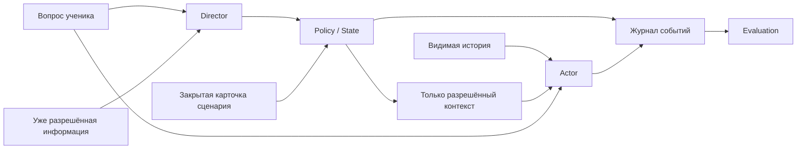

# Минимальная техническая концепция

Назначение — тренировать вопрос ученика и естественный ответ виртуального клиента на немецком, управляя доступом к заранее заданным скрытым фактам. Это проектный каркас: FastAPI и UI появятся в отдельной миссии.

## Director

Семантически классифицирует только актуальный вопрос: A/B/C/PRESSURE/NONE. Уже открытая информация — состояние, а не источник дополнительных категорий. Текущая поломка сама по себе не даёт основания открыть прежний неудачный ремонт. Неоднозначность сохраняет тайну. Возвращает JSON с категориями, причинами и уверенностью.

Подтверждённая версия находится в `research/feasibility/feasibility_spike.py`, её копия и SHA-256 зафиксированы манифестом. Не переносить её через пересказ или незаметную правку промпта. В MISSION 01 создаётся только контракт, не новая реализация классификации.

## Policy / State

Детерминированный код владеет закрытой карточкой, накоплением разрешений и состоянием реакции. Он проверяет структуру решения, учитывает уверенность, рассчитывает переход состояния и записывает причину каждого разрешения. Набор разрешённых фактов передаётся Actor отдельно от полной карточки. Само решение Director ещё не доказывает правильности разрешения: это проверяется эталонами и аудитом.

## Actor

Получает открытое описание, видимую историю, только разрешённые факты и состояние реакции; не получает закрытую карточку, причины Director или эталонные категории. Отвечает по-немецки в роли клиента. Не управляет раскрытием и не выставляет себе оценку. Неподтверждённые симптомы/сроки сейчас являются открытым дефектом, не допустимым способом обогащения сценария.

## Evaluation

Потребляет журнал событий и сценарные критерии. Отдельно оценивает вопрос, корректность разрешения, действительно озвученные части фактов, давление и последовательность. `allowed_after` не означает, что ученик услышал каждую часть факта. Источником оценки служат события и явные правила, а не самооценка Actor. Алгоритм оценки и итоговые баллы в этой миссии не реализуются.

## Данные и границы

Контракты Python в `backend/app/` документируют будущие границы. Они не работают как LLM-заглушки и не используются для симуляции интеграционных тестов. Исторический PoC использует один Python-процесс, поэтому изоляция запроса Actor — архитектурная дисциплина, не доказанная граница безопасности между процессами.

Исследовательский архив остаётся неизменным. Новые реальные журналы сохраняются в игнорируемом `reports/private/`. Ключ существует в памяти/окружении локального процесса; в сценарии и журналы он не входит. Новые зависимости, БД, серверы, Docker, n8n и внешнее развёртывание в этой миссии не нужны.
