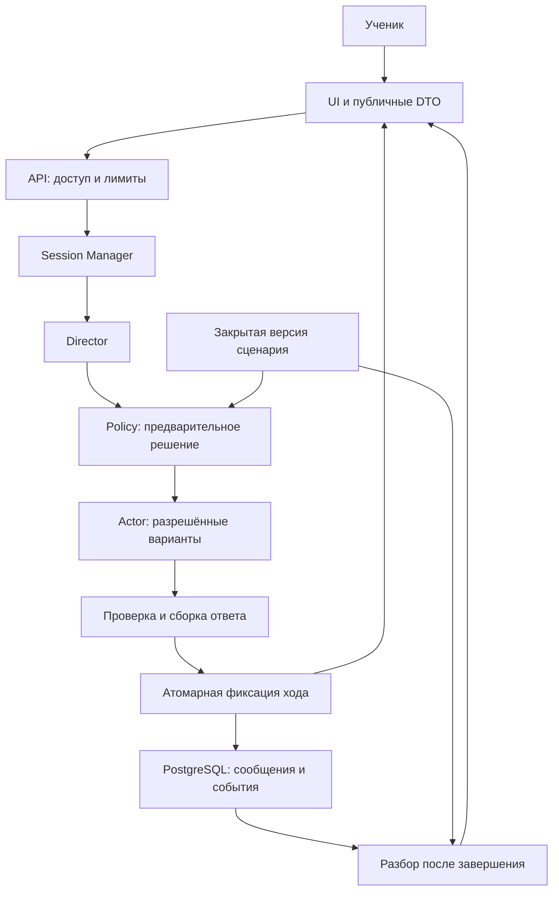

# A01 — Архитектура системы

**Статус:** проектное предложение, не реализованная система. **Дата:** 2026-11-05. **База исследования:** `2962a1b89cb8c9816decc8322ec92259993b3b03`. Dashboard, границы выпуска и стратегия Actor ожидают решения владельца в [OPEN_DECISIONS.md](OPEN_DECISIONS.md).

## 1. Архитектурное решение

**Уточнение A01.1:** [CONSULTATION_CORE.md](CONSULTATION_CORE.md) становится источником учебной логики: последовательные этапы потребностей/возможностей, проверенные резюме, состояния неизвестности и пригодность итогового действия. Технический поток ниже сохраняется, но сбор emitted A/B/C больше не достаточен для разрешения предложения. Полный новый semantic gate ещё не реализован/проверен.

Предлагается **модульное приложение на Python в одном backend-процессе**, PostgreSQL и интерфейс, который обслуживается тем же приложением. Внутри выделены **16 логических модулей**, описанных в [MODULE_CATALOG.md](MODULE_CATALOG.md). Это границы ответственности и проверки; шестнадцать отдельных сервисов не нужны.

Одна тренировка проходит полный путь: выбор утверждённого клиента → разговор на немецком → фиксируемые события раскрытия → разбор → повторная попытка. Скрытой карточкой владеет сервер. LLM распознаёт смысл вопроса и участвует в выборе ответа; код управляет разрешениями, сохранением, составлением проверенного ответа и подсчётом результатов. Объяснения качества разговора остаются AI-подсказками с проверяемыми цитатами.

Основания: исходный PDF, стр. 1–5; [существующая архитектура](../ARCHITECTURE.md); [handoff](../PROJECT_HANDOFF_FOR_ASTRA.md). В базе нет HTTP-приложения, БД или UI; четыре Python Protocol не являются их реализацией.

## 2. Минимально достаточный стек

| Компонент | Предложение | Почему и граница |
|---|---|---|
| Прикладная логика | Python + FastAPI + Pydantic | Сохраняет язык PoC, позволяет выразить строгие входные/выходные схемы и единый API. Архивный runner не становится web backend простым импортом. |
| Интерфейс | Jinja2, HTML/CSS, небольшой JavaScript | Для 8 дней достаточно форм, чата, разбора и простого редактора; нет отдельной сборки SPA. JSON API отделяет домен от представления. Переход к React возможен позднее, но потребует работы над UI. |
| Данные | PostgreSQL, SQLAlchemy, Alembic | Нужны транзакции, уникальность повторных запросов, версии и миграции. Локальная БД в Docker; новый облачный сервис не требуется. JSONB подходит для версионированной карточки, связи/владельцы/ходы остаются структурными колонками. |
| Вызовы моделей | Один внутренний Provider Gateway, первоначально OpenAI Responses | Director/Actor/Feedback имеют отдельные профили; вся квота, тайм-ауты и нормализация ошибок в одном месте. Конкретная доступность модели проверяется в будущей разрешённой приёмке. |
| Запуск L1 | Mac, localhost, Docker Compose для БД; приложение локально или вторым контейнером | Один владелец, управляемая демонстрация; loopback-порты, без публичного доступа. Интернет нужен для LLM. Это не офлайн AI. |
| Последующий запуск | Изолированный compose-проект на имеющемся Hetzner, TLS, резервирование | Только отдельная deployment-миссия после приёмки и проверки доступа. Существующие n8n/VPS-сервисы не меняются в A01. |
| Проверки | unittest/pytest для кода, отдельные сохранённые eval-наборы, браузерные acceptance-сценарии | Инженерные тесты не доказывают качество LLM; реальные eval требуют бюджета, результатов и ручной смысловой проверки. |

Для первого релиза не нужны Redis, Celery, Kubernetes, vector DB, RAG, MCP-прокси, event broker или несколько backend-сервисов. n8n может позже обслуживать согласованные уведомления/административные процессы; последовательность каждого диалога остаётся в Python. Нет запроса к внешнему поиску или CRM из роли клиента.

SQLite проще для одноразовой демонстрации, но параллельная поддержка двух БД увеличит проверку и миграции. Рекомендация — одна PostgreSQL уже с L1; это проектный выбор, а не требование продукта. Версии Python, библиотек и контейнеров закрепляются совместимым lockfile/digest в этапе S1, не выбираются автоматически как «latest».

FastAPI официально поддерживает Jinja2Templates; PostgreSQL предоставляет ограничения уникальности и транзакции. Эти возможности поддерживают выбор, но сами по себе не реализуют идемпотентность приложения: [FastAPI templates](https://fastapi.tiangolo.com/advanced/templates/), [PostgreSQL constraints](https://www.postgresql.org/docs/current/ddl-constraints.html), [transaction isolation](https://www.postgresql.org/docs/current/transaction-iso.html).

## 3. Поток и границы

Provider Gateway обслуживает вызовы Director, Actor и дополнительного Feedback. Прямого доступа этих компонентов к ключам/HTTP-провайдеру вне Gateway нет. M14 считает попытки/ошибки и ограничивает бюджет. M16 проверяет каждую границу и версию перед выпуском.

Полный L1 требует нового versioned профиля Director для предложения решения/мягкой срочности. Архивный prompt сохраняется как проверяемая база, но его 74/74 не доказывает новые сигналы. Policy отдельно определяет ранность предложения по фактам, выясненным до текущего хода; содержательная диагностическая просьба не равна преждевременному offer. Это обязательная функция исходного PDF, а не необязательное украшение будущей аналитики.

| Получатель | Разрешённые данные | Недопустимые данные |
|---|---|---|
| Браузер до завершения | Публичная ситуация, собственные реплики, ответы клиента, номер хода, технический статус | Закрытые факты, ответы для разбора, внутренние причины Director, prompts, ключи. Скрывать JSON через CSS недостаточно. |
| Director | Текущий вопрос, разрешённое состояние и описание категорий; для legacy — ровно проверенный формат | Значения ещё закрытых фактов и эталонные ответы тестов. Добавление истории — новая версия, не незаметная адаптация. |
| Policy | Полная карточка, решение Director, состояние | Непроверенные permissions/roles/факты, присланные браузером. |
| Actor | Публичные сведения, разрешённые атомы/варианты, состояние реакции, доверенная история | Полная карточка, запрещённые варианты, эталоны, ключи; текст ученика не становится источником фактов. |
| Evaluation после завершения | Закрытая карточка данной версии, зафиксированный журнал и ответы | Другие сессии/пользователи, неполученные ответы API как доказательства. |
| Автор сценария | Собственные карточки и preview-сессии | Автоматический доступ к личным тренировкам учеников. |

Это дисциплина данных внутри приложения, а не доказанная изоляция процессов или защита от администратора сервера. Для нескольких пользователей необходима проверка владения на каждом endpoint и репозитории данных; конкретные меры — [SECURITY_AND_GDPR.md](SECURITY_AND_GDPR.md).

## 4. Один ход как транзакционная операция

1. Клиент отправляет `session_id`, `client_turn_id`, `expected_version`, текст. Сервер определяет владельца из сессии доступа, а не из body.
2. Короткая транзакция резервирует запрос с хешем нормализованного payload и lease/fencing-token. Для той же сессии разрешён один активный ход. Повтор с тем же ключом и иным payload получает конфликт.
3. После закрытия этой транзакции выполняются внешние вызовы. Нельзя держать блокировку PostgreSQL во время ожидания LLM. Политика вычисляет **предварительное** состояние; пользовательский результат ещё не изменён.
4. Actor возвращает выбор разрешённых фрагментов. Сервер проверяет выбор, собирает текст и метаданные реально включённых атомов. Подробности и альтернативы — [AI_ENGINE_DESIGN.md](AI_ENGINE_DESIGN.md).
5. Короткая транзакция проверяет lease-token, неистёкший lease, статус запроса `running`, активную сессию и её ожидаемую версию, затем одновременно сохраняет сообщение ученика, ответ клиента, изменение состояния, события и результат turn-request. Отменённый/удалённый/закрытый запрос не может commit. Только этот момент увеличивает счётчик завершённых ходов.
6. HTTP-ответ содержит уже сохранённый результат. Если связь оборвалась после commit, повтор/GET возвращает тот же текст без нового вызова модели.

Тайм-аут/503 до готового ответа сохраняет отдельную техническую попытку; он не фиксирует раскрытие и не наказывает ученика. Новая попытка использует тот же пользовательский запрос, ограниченный общий бюджет попыток и новый fencing-token. Поздний результат старого worker не может перезаписать более новое состояние. Если ответ уже зафиксирован, клиент сначала восстанавливает его, а не генерирует заново.

Выражение «один результат хода» относится к локальному commit. Гарантировать ровно один платный вызов внешнего API при сетевом тайм-ауте нельзя. Возможная стоимость неизвестно завершившегося запроса учитывается резервом, а не приравнивается к нулю.

## 5. API-контракт — эскиз, не реализация

| Метод/ресурс | Функция | Ключевая проверка |
|---|---|---|
| `GET /api/v1/scenarios` | Утверждённые публичные карточки | Только опубликованные публичные поля. |
| `POST /api/v1/sessions` | Создание тренировки с фиксированной версией | Доступ, квота, лимит активных сессий. |
| `POST /api/v1/sessions/{id}/turns` | Отправка одного вопроса | Владелец, активный статус, идемпотентность, версия, длина. |
| `GET /api/v1/sessions/{id}` | Восстановление текущего разговора | Публичный DTO; никаких ещё скрытых фактов. |
| `GET /api/v1/sessions/{id}/turns/{client_turn_id}` | Проверка результата после обрыва | Тот же владелец, без новой генерации. |
| `POST /api/v1/sessions/{id}/finish` | Завершить и запустить разбор | Идемпотентно; нет незавершённого хода. После раскрытия карточки разговор нельзя продолжить. |
| `GET /api/v1/sessions/{id}/evaluation` | Получить разбор и статус AI-подсказок | Только завершённая собственная сессия. |
| `DELETE /api/v1/sessions/{id}` | Удалить данные тренировки | Отмена pending, удаление зависимостей, будущих exports/shares. |
| `POST/PATCH /api/v1/author/scenarios/...` | Черновик, новая версия, проверка | Роль автора, собственная карточка, схема и revision. |
| `POST /api/v1/author/scenarios/{id}/publish` | Выпуск утверждённой версии | Валидный контент, review и acceptance; редактирование live-версии запрещено. |

Успех возвращает `data` и `request_id`; ошибка — `error.code`, понятное `message`, `retryable`, `request_id`. `409` — версия/занятый ход/несовпадение idempotency payload; `422` — вход; `429` — лимит с Retry-After; `503` — временная недоступность upstream; `504` — дедлайн. Содержание provider error и prompts не отправляется в браузер. `202` допустим для уже идущего запроса/разбора; UI восстанавливает статус по GET. Это API-схема для будущей реализации, а не набор существующих endpoints.

## 6. Эксплуатационные пределы L1

Предлагаемые настройки для измерения, не достигнутые показатели: одна активная генерация на пользователя; до 15 **реплик ученика** (толкование требует согласования); 2 000 символов на ввод; до 3 коротких предложений клиента; ограниченный список утверждённых ответных фрагментов. Не обрезать вопрос молча: показать превышение лимита.

Базово два LLM-вызова на ход и один необязательный вызов объяснений в конце. Всего до 31 успешного вызова за 15 ходов, без повторов; счётчик попыток и резерв затрат больше и ограничены отдельно. Владелец утверждает потолок в евро до запуска. Исторические token usage не преобразуются в вымышленную денежную стоимость.

Предлагаемые технические границы: до 20 секунд на одну попытку этапа, максимум один повтор этапа и общий deadline хода 60 секунд. Общий deadline имеет приоритет: четыре ожидания по 20 секунд не допускаются. Повторами владеет один слой Gateway; повторы SDK отключены/учтены, повтор браузера не сбрасывает серверный бюджет. Это настройки для будущей проверки, не измеренная скорость сервиса.

Нет streaming необработанного Actor-текста в L1: проверка проводится до показа. Для ожидания — доступный индикатор и возможность восстановить запрос. Worker перезапущен — pending-запрос обнаруживается по lease и становится восстанавливаемым; неисправная операция не исчезает и не получает фиктивный PASS.

## 7. Развитие без раннего усложнения

L2 добавляет личную историю, экспорт/удаление, приглашённый доступ и проверенный deployment. L3 — организации, разграничение tenant, добровольный sharing, платёжные права и поддержку. L4 — голос, новые сценарии, Angebot. Голос подключается к тому же контракту текста и событий после согласования latency/privacy; он не обходит Policy.

Полный путь пользователя и роли: [USER_ROLES_AND_FLOWS.md](USER_ROLES_AND_FLOWS.md). Состояния и ограничения данных: [DATA_MODEL.md](DATA_MODEL.md). Этапы, даты относительно старта и условия остановки: [DEVELOPMENT_ROADMAP.md](DEVELOPMENT_ROADMAP.md). A01 завершается проектированием и передачей Dashboard на обсуждение.
