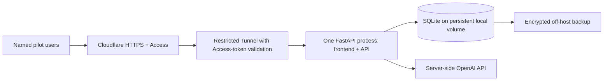

## MISSION 06.1 — актуальное дополнение, 24.11.2026

Подготовлены действительные Docker/CI adapters и исправленный privacy contract в той же working branch. [Pilot runbook](TRAINER_PILOT_RUNBOOK.md), [Access plan](TRAINER_ACCESS_PLAN.md), [Python Security CI](TRAINER_SECURITY_CI.md), [read-only VPS admission](TRAINER_VPS_PREFLIGHT.md) определяют текущие условия. Ни публикации, ни перенос данных/секретов, ни изменение working infrastructure не выполнялись. Native advisories и непроверенные activation gates не выданы за PASS. Ниже сохранена историческая MISSION06 оценка.

---

# Trainer Cloudflare Feasibility

## Рекомендация для пилота

Выбран **вариант B: один native FastAPI backend, общий origin для frontend и API, Cloudflare HTTPS/Tunnel/Access перед ним**. Он сохраняет текущие SQLite, роли, CSRF, PDF и файловые операции. Владелец подтвердил наличие оплаченного VPS/сервера: основной план — использовать его без новой аренды. ОС/архитектура, свободные ресурсы, изоляция и backup пока NOT VERIFIED; удалённая проверка не выполнялась. Новые ресурсы не создавались.

Вариант A технически возможен: FastAPI поддерживается Python Workers. Однако текущий SQLite-файл недолговечен в isolate; нужен перенос store/auth на D1, часть файлов — в R2, замена ffprobe/pdftotext и проверка Argon2/ReportLab/Pillow/шрифтов и HTTP-транспорта. Это отдельная миграция, а не смена команды запуска.

Для B используем подтверждённый владельцем оплаченный VPS; ожидаемая добавочная стоимость compute — $0 при достаточной свободной ёмкости. Cloudflare Access может укладываться в бесплатный тариф до 50 пользователей; расходы на backup/domain/AI и возможное изменение тарифа остаются отдельными. Новая аренда не предлагается как основной путь. Workers Paid начинается с $5/месяц. OpenAI оплачивается отдельно по использованию. Подробные границы, расчёты и первичные источники ниже.

23.11.2026, Europe/Berlin. MISSION 06. Source: `klarekipro/Beratungsgespr-ch-Trainer`, audited main `332a4f4d7f919fc570d9e8d44de2d9be326e7677`. Working branch: `codex/mission-06-cloudflare-readiness`. Planning/audit only; no push, merge, deployment, data transfer, new remote repository, cloud resource or secret transmission.

Decision: **B — one native FastAPI backend behind Cloudflare Tunnel/HTTPS/Access, keeping frontend and API on one hostname.** This is a proposed pilot design, not a deployment. The owner confirmed an already-paid VPS/server; reuse that host rather than provisioning a new VM. Its OS/architecture, free capacity, isolation and backup setup have not been remotely verified. Do not rewrite persistence or split frontend/API merely to get an edge hosting label.

For minimal pilot scope, use an approved immutable source SHA from the existing project. A new private shared development repo is optional and separately approved; application users do not need GitHub collaborator seats.

## Compatibility and necessary changes

| Concern | A: Python Workers + D1/R2 | B: native FastAPI + Cloudflare edge |
|---|---|---|
| FastAPI | Supported through Cloudflare ASGI adapter; replace Uvicorn entrypoint and add python_workers configuration | Keep current ASGI app and native CPython/Uvicorn; new pilot entrypoint/service definition only |
| SQLite | A local sqlite3 file is not durable/shared across isolates. Port repository/auth/workflow queries and transaction/version semantics to asynchronous D1 bindings; not a connection-string swap | Keep WAL and existing transaction semantics on a persistent disk; one worker for pilot, no shared/network filesystem |
| Imported originals/profiles | D1 metadata plus R2 objects where payload size/retention warrants it; explicit async object references and authorization | Existing versioned SQLite records and any approved runtime override directories on private persistent volume; no R2 required just for pilot |
| File I/O | Bundled read-only assets vs ephemeral scratch need separation; chmod/path ownership assumptions are not a durable security boundary | Current pathlib/file permissions work; package assets separately from writable data/log/temp directories |
| ffprobe / pdftotext | Existing native subprocess calls cannot simply run in Workers. Replace, remove with explicit product acceptance, or externalize; the latter adds another backend | Install approved OS packages in the later runtime build and preserve file/pipe protocol restrictions and timeouts |
| ReportLab/fonts | Exact ReportLab/Pillow/font stack on Pyodide **NOT VERIFIED**. Existing font lock/native dependencies also need compatibility/memory/CPU tests | Local native PDF test passes; package licensed DejaVu regular/bold fonts on Linux and repeat smoke there |
| Argon2/Pydantic/HTTPX | Exact wheels/transports and concurrency behavior must be proven. Argon2 currently uses 64 MiB per hash; benchmark against Workers limits rather than assuming Free fits | Keep native bindings; pin Linux wheels and cap login/concurrency; no cryptographic redesign |
| Frontend | Use Workers asset bindings and preserve portal authorization/cache semantics | Serve current static assets through the same FastAPI origin proxied by Cloudflare; avoid new CORS/cookie complexity |
| OpenAI secret | Worker secret binding, never browser bundle; adapt request-scoped bindings/HTTP transport | Owner-managed server secret injected into one process; do not move Keychain contents or reuse a GitHub secret in PR jobs |
| Maintenance/rollback | App + D1 migration + R2/reference changes and compatibility version; code rollback alone cannot undo data schema changes | Immutable code release plus existing schema-compatible SQLite; code rollback first, data restoration only explicitly approved to avoid losing new conversations |

Python Workers genuinely support FastAPI; the reason for choosing B is this application's storage/native-tool contract. A may be a later project after a synthetic compatibility prototype. No Workers package/toolchain was installed or trial deployment created.

## File/OS-operation inventory

| Current path / operation | Required treatment |
|---|---|
| store.py:27–52 creates directories, sqlite3 file, WAL, chmod, transactions | Durable volume in B; repository redesign in A |
| auth.py users/auth_sessions/login_limits/training_owners | Keep durable atomic state; do not move sessions into eventually consistent KV |
| server.py:112–133 startup seed/upgrade, runtime token and optional audit directory | Isolate pilot data before import/startup; do not point at the working DB |
| client_profiles.py / persona_service.py reads shipped and optional runtime profiles | Immutable shipped JSON plus explicitly backed-up authored state; preserve old profile/material snapshots |
| company_reference.py:119–158 ZIP/XML XLSX and temporary PDF + pdftotext | Retain bounded import behavior; port native extraction only if A is chosen |
| transcription.py:12–35 mkstemp, fdopen, ffprobe, unlink; server.py:680–704 process semaphore/rate state | Native constrained process in B; no OS-binary assumption in A. Never store temporary audio as CI artifacts |
| exports.py:78–104, certificate_design.py, learning_exports.py | Fonts must exist and PDF text/layout must round-trip; BytesIO generation is not the blocker by itself |
| review_diagnostics.py:18–48 private failure bundles | Persistent private directory/retention if enabled in B, no CI export; redesign storage/authorization if A |
| server.py startup Git/file hashes and static frontend files | Record immutable source SHA and package required static/material files; do not include runtime DB in image |
| scripts/local_installation.py, mac_keychain.c, .command launchers | macOS-only operational layer; keep original local install untouched and introduce a separate Linux/pilot launcher |
| historical research/scripts/reports archives | Not active pilot runtime; do not copy them wholesale into a shared release |

A static AST inventory found 59 file/OS call sites under backend and 88 under scripts; the table groups their operational implications. Test/research operations are counted separately, not treated as runtime requirements.

## A-specific recovery plan

If A is later chosen, D1 Time Travel currently retains seven days on Free / thirty days on Paid. Plan independent logical exports and staging restores as well. R2 originals need immutable/version-identified object keys and a manifest matched to the D1 data snapshot; database time travel alone does not restore a matching object set. Cross-store recovery/schema compatibility is another implementation and acceptance task, not a tested backup in this mission. Never weaken current auth or replace reviewed Argon2 solely to make a package fit Workers.

## Access, secrets and data

For B protect the **whole hostname**, including API, login, status, static and export paths, using named-user Access rules. Validate Access application tokens at cloudflared (Protect with Access) or a reviewed origin verifier; an email header alone is not authentication. Origin must not be publicly reachable by an alternate IP/port. Retain application accounts, role/ownership checks and CSRF; Access is an outer gate.

Keep one origin so same-origin checks and Strict cookies remain valid. Configure TRAINER_REMOTE_HTTPS=1 and the exact TRAINER_ALLOWED_HOSTS; trust forwarded scheme/client information only from the actual proxy address, not arbitrary sources. Do not set a wildcard host/proxy trust to work around a failed test.

Use fresh synthetic pilot accounts/data after approval. No working SQLite or auth sessions are transferred. Desired backup targets: daily encrypted SQLite backup API snapshot + before each release, seven daily copies and a separately tested off-host restore. RPO 24h / RTO 2h are proposed targets, not measured guarantees. Include necessary authored material/profile files; exclude sessions/secrets from shared artifacts.

## Cost assumptions — verified price sources, not a bill

| Component | Expected pilot cost / limitation |
|---|---|
| A Workers | Free has 100k requests/day, 10 ms CPU/request and 128 MB memory. Existing Argon2/PDF stack is not benchmarked for that envelope. Paid minimum is $5/account/month, plus usage beyond allowance |
| A D1 | Free allowance currently 5M rows read/day, 100k written/day, 5 GB total. Usage/data limits must be measured; scans do not replace capacity planning |
| A R2 | Standard free tier includes 10 GB-month, 1M Class A and 10M Class B operations; beyond it storage is $0.015/GB-month plus operations. No R2 account/bucket was created |
| B backend | An already-paid VPS/server is **owner-confirmed**; expected incremental compute is $0 if sufficient compatible capacity is available. Capacity/OS/storage/isolation/backup remain **NOT VERIFIED**. No new VM or provider is selected. Verify whether disk, off-host backup, domain and traffic are already included; any incremental service requires a separate owner decision |
| Cloudflare Access | Public pricing lists Free for up to 50 users. Actual account entitlement/configuration not checked; no SLA/long log retention is implied |
| OpenAI | Metered separately. Current documented gpt-4.1-mini rates are $0.40 input / $1.60 output per 1M tokens. Example only: 1M input + 100k output = $0.56, excluding transcription, retries and other models. No live model/spend test performed; pinned snapshot is marked Deprecated |
| Security CI / shared repo | No hosted job in this mission. Team plan exists, but remaining Actions allowance, overage controls and collaborator-seat increment are not verified; do not promise free expansion |

Choose B because it preserves tested storage/auth/export code and requires fewer coupled changes. The confirmed paid VPS is the preferred always-on host, subject to resource/OS verification; using the owner's desktop is suitable only for an explicitly time-boxed supervised demo, with sleep/uptime accepted and an isolated pilot instance, never an accidental tunnel to the working database.

Sources checked 23.11.2026: [Python/FastAPI](https://developers.cloudflare.com/workers/languages/python/packages/fastapi/), [Python stdlib/filesystem](https://developers.cloudflare.com/workers/languages/python/stdlib/), [packages](https://developers.cloudflare.com/workers/languages/python/packages/), [Workers limits](https://developers.cloudflare.com/workers/platform/limits/), [Workers pricing](https://developers.cloudflare.com/workers/platform/pricing/), [D1 pricing](https://developers.cloudflare.com/d1/platform/pricing/), [D1 recovery](https://developers.cloudflare.com/d1/reference/time-travel/), [R2 pricing](https://developers.cloudflare.com/r2/pricing/), [Access pricing](https://www.cloudflare.com/plans/), [Access origin validation](https://developers.cloudflare.com/cloudflare-one/access-controls/applications/http-apps/self-hosted-public-app/), [OpenAI model/pricing](https://developers.openai.com/api/docs/models/gpt-4.1-mini).
