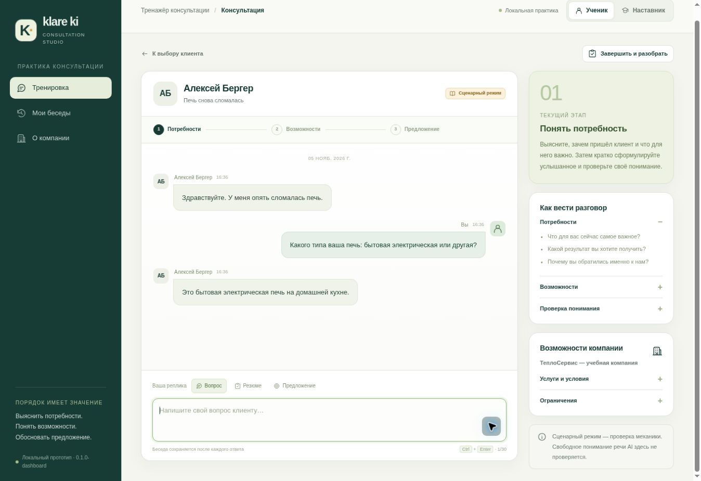
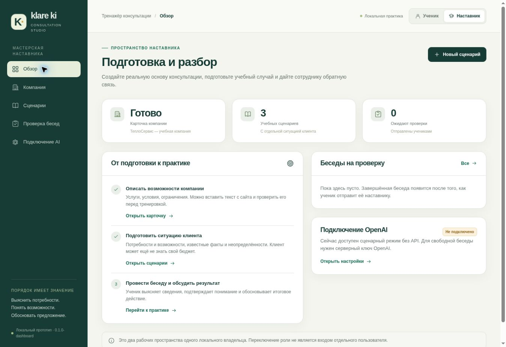

# ASTRA A02 — функциональный dashboard консультации

Дата: 2026-11-05. Основание: новая инструкция владельца сразу создать рабочие интерфейсы наставника/директора и сотрудника/ученика, Python backend, ввод возможностей компании, диалог, документ разбора и подключение AI. Она разрешает реализацию после документального этапа A01.1.

База разработки: `988941441921563bdd82598c7b8a4f44eb0facbd`, дерево `d5796c83e303dee2af066c7e2c5a1a2d5ec9d27e`. Реализация подготовлена в отдельной ветке `feat/consultation-dashboard`. Исходная `main` — `2962a1b89cb8c9816decc8322ec92259993b3b03`; слияние и публичное развёртывание в эту работу не входят. Документы A01 остаются предшествующей историей.

## Результат

Рабочий локальный прототип с двумя интерфейсами одного владельца. FastAPI обслуживает HTML/CSS/JavaScript с того же адреса. SQLite сохраняет компанию, карточки клиентов, беседы и отзывы. Установка и запуск описаны в [инструкции](../docs/implementation/DASHBOARD_QUICKSTART_RU.md); контракт — в [DASHBOARD_API.md](../docs/implementation/DASHBOARD_API.md).

| Рабочее место | Реализованное поведение |
|---|---|
| Наставник | Описание компании, ссылка и вставленный текст источника; услуги, условия, ограничения и ручное подтверждение сведений |
| Наставник | Создание, редактирование и удаление сценариев; открытая вводная, закрытые факты, неопределённости, обязательность сведений и допустимые исходы |
| Наставник | Очередь переданных учеником разборов; просмотр диалога и сохранение отзыва |
| Ученик | Каталог клиентов, выбор режима, вопросы, резюме, итоговое предложение, индикатор этапов |
| Ученик | История, продолжение и повтор; завершение незаконченной попытки с честным статусом |
| Ученик | Разбор, полная расшифровка, скачивание PDF/TXT/JSON, передача в очередь и просмотр отзыва |

Внешняя отправка email/мессенджеров не реализована. Кнопка передачи создаёт внутреннюю запись. Сайт компании не загружается автоматически: наставник вставляет и проверяет текст. Начальные данные относятся к вымышленной учебной компании.

## Учебное правило и границы гарантии

Движок хранит отдельные состояния: потребности → возможности → предложение → завершено. Сам факт заданного вопроса этап не закрывает. Сначала должны быть раскрыты обязательные сведения, затем подтверждено резюме ученика с проверяемыми цитатами. Доступ к итоговому действию открывается после обоих подтверждений. Диагностика также считается предложением. Обоснованный отказ `no_fit` является допустимым успешным исходом.

Попытка предложения раньше времени сохраняется в разборе, даже если ученик затем исправил последовательность. Вопрос о предпочтении ремонта отличается от предложения ремонта. Ранний ответ о возможностях не теряется, но нарушение порядка отмечается. Новый существенный факт может отменить прежнее подтверждение. Ученик может завершить попытку без достижения финального этапа; это не превращается в успешную консультацию.

«Бюджет ещё не определён», «клиент не знает» и «отказывается раскрыть» — явные состояния карточки. Пустое обязательное поле автора отклоняется. Неизвестный бюджет не заменяется придуманной суммой. Нельзя сделать подтверждённым факт, который ученик лишь угадал до раскрытия.

Программная последовательность отделена от распознавания смысла. В сценарном режиме используются ограниченные ключевые слова и консервативное сопоставление резюме; точные примеры находятся в [техническом walkthrough](../scenarios/dashboard_demo_walkthrough.json). Это подсказанный прогон, не независимый экзамен. В режиме OpenAI распознавание выполняет модель и может ошибаться. Программа валидирует структуру, ссылки, цитаты и допустимость перехода; сама по себе эта проверка не доказывает смысловую правильность каждого решения.

## Подключение OpenAI

Реализован серверный адаптер Responses API через HTTP. Используется строгая JSON-схема результата, `store: false`, ограничение ответа и тайм-аут. Один ход вызывает одно распознавание; автоматических повторов и скрытого перехода на сценарный ответ нет. После сбоя диалог и учебное состояние не продвигаются. Число live-попыток сохраняется отдельно; по умолчанию лимиты — 30 ходов и 30 попыток на беседу.

Модель получает обозначения ещё не раскрытых тем, раскрытые значения, видимый контекст и возможности компании. Закрытые значения и эталон допустимого исхода не передаются как подсказка распознавателю. Ответ клиента собирается из утверждённых автором фактов и контролируемых реакций. Свободная генерация клиентских фактов в A02 не используется. Это осознанная граница первого рабочего ядра.

Ключ вводится в скрытом запросе `python scripts/serve_dashboard.py --openai` либо приходит из защищённого окружения процесса. Приложение не записывает его в файл и не передаёт браузеру. Статус настройки показывает наличие ключа и модели, но не удостоверяет успешный платный запрос. В рабочей среде этой миссии ключ отсутствует; **реальных OpenAI-вызовов не было**. Доступ к выбранной модели и качество свободных русских формулировок ещё предстоит проверить намеренным живым прогоном.

Форма Responses и Structured Outputs сверена с официальными руководствами: [генерация текста](https://developers.openai.com/api/docs/guides/text), [Structured Outputs](https://developers.openai.com/api/docs/guides/structured-outputs). Строгая схема не гарантирует семантическую корректность.

## Сохранение и ограничения эксплуатации

SQLite использует параметризованные запросы и версии записей. Начатая беседа получает неизменяемые снимки компании и сценария. Редактирование или удаление исходной карточки не переписывает прошлую беседу. Идемпотентный идентификатор отправки и проверка версии предотвращают повторный ход при обычном повторе доставки. После удаления сценарий не восстанавливается автоматически при перезапуске.

Repository отделяет сохранение от учебного движка. **PostgreSQL-адаптера и миграций пока нет**; одна переменная `DATABASE_URL` не переключит базу. Для следующего этапа нужны адаптер, миграции и перенос данных.

Два рабочих места сейчас переключаются у одного локального владельца. Заголовок рабочего места не является аутентификацией. Для нескольких независимых пользователей нужны аккаунты, принадлежность сессий, права на разбор, конкурентная работа нескольких процессов и HTTPS. Launcher слушает loopback; это локальный прототип, не готовое интернет-развёртывание.

## Проверка реализации

Среда: Python 3.12.14. Версии зависимостей закреплены в `requirements-dashboard.txt`. Общий запуск: `python -m unittest discover -s tests/dashboard -v` — **36/36 PASS**. Проверка `node --check frontend/app.js` — PASS. FastAPI TestClient выдал предупреждение об устаревающем способе использования httpx; тесты завершились успешно на закреплённых версиях.

| Проверка | Результат и предел |
|---|---|
| 20 тестов движка и транспорта | Последовательность, доказательства резюме, ранние предложения, неопределённость, допустимые исходы, ошибки провайдера и проверка запроса; транспорт подменён, API не вызывается |
| 16 HTTP-тестов | Реальный FastAPI TestClient и временная SQLite: сохранение, снимки, приватность активной карточки, повторная доставка, конфликт версий, редакторы, экспорт, очередь, ошибки и лимиты |
| Настольный браузер | Оба интерфейса, раннее предложение, вопросы и резюме, финал, перезагрузка и восстановление, разбор, PDF, передача, отзыв и его отображение ученику |
| Редакторы через интерфейс | Сохранение новой ревизии компании; добавление обязательного факта в сценарий; новая беседа использует исправленную карточку |
| PDF | Реальный браузерный download: 5 страниц; кириллица и текст извлечены; все страницы отрендерены и просмотрены, наложений/обрезки не обнаружено |

Скриншоты реального проверенного интерфейса:

Мобильная визуальная проверка не выполнялась. В прочитанном хвосте консольного журнала были сообщения расширения браузера о передаче метаданных; это не использовано как доказательство чистоты всего консольного журнала приложения.

### Дефекты, обнаруженные и исправленные в ходе проверки

1. Сценарный распознаватель не принимал одну из форм слова о замене оборудования. Исправление проверено тестами допустимого финального действия.
2. В первом сценарии исход предполагал бытовую электрическую печь, хотя тип оборудования ещё не выяснялся. Добавлен обязательный факт `equipment`, отдельный вопрос и включение этого сведения в резюме потребностей; карточка `oven_uncertain` имеет revision 2. Проверка не позволяет закрыть этап угадыванием нераскрытого типа. Технический walkthrough обновлён. После исправления повторно прошли все 36 тестов.
3. Финальное чтение контрактов выявило, что ID сценария с начальным дефисом/подчёркиванием можно было сохранить, но нельзя использовать для начала беседы. Валидация сохранения согласована с валидацией запуска; существующий HTTP-тест дополнен этими двумя случаями. Пустой ID для автоматического создания сохранён.

PDF проверял механизм экспорта из первой браузерной QA-попытки, начатой до исправления карточки; этот временный PDF не распространяется как корректный эталон консультации. Скриншот ученика показывает новую попытку после исправления. Сохранённые снимки прежних бесед намеренно не менялись.

## Приёмка и следующий конкретный шаг

**Функциональный локальный цикл реализован и проверен.** Реальная надёжность OpenAI и эффективность обучения не приняты этими тестами. Исторические результаты 74/74 и статус Actor MISSION 02 не пересчитаны и не объявлены исправленными новым прототипом.

Следующий шаг владельца: запустить приложение, проверить учебную компанию и сценарии, затем подключить свой ключ скрытым вводом и пройти один реальный разговор на русском. Сравнить реплики и решения о переходах с содержанием карточки. После этого корректировать распознавание и сценарии, а для совместной эксплуатации — добавить PostgreSQL и реальные права пользователей.

В публикацию включаются исходники, тесты, инструкции и синтетические скриншоты: 82 файла, из них относительно базы A01.1 — 22 новых и 6 изменённых. Побайтно сверены и сохранены исследовательский архив, оригинальный продуктовый PDF и старые файлы `backend/app/` вне нового пакета dashboard. В изменённых текстах проверены сигнатуры API-токенов и приватных ключей; совпадений нет. Локальные базы, ключи, временные экспорты, кэши и сырые API-архивы в состав поставки не входят.
