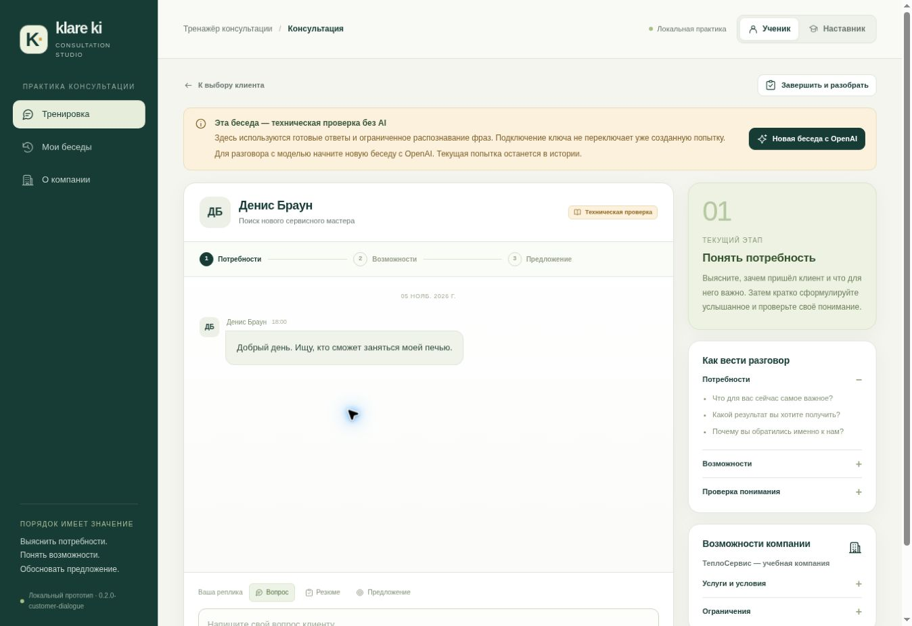

# ASTRA A03 — разговорная роль клиента и ясность режима

Дата: 05.11.2026. Версия приложения: `0.2.0-customer-dialogue`.

**Исправлены выбор режима, устройство ответа клиента и учёт фактических AI-вызовов. Естественность и смысловая надёжность реальной модели ещё требуют живой проверки.**

## 1. Что показал первый пользовательский разбор

В приложенном пользователем PDF `klareki-dialog-2065e4f14926.pdf` на первой странице указан **«Сценарный режим · без AI-вызовов»**. В расшифровке на странице 2 четыре из пяти ответов клиента повторяют «Уточните, пожалуйста, что именно вы хотели бы узнать». Вопросы о смысле предыдущей реплики, номере/мощности печи и причине поломки не получили содержательного ответа.

Эта попытка не проверяла OpenAI. Само наличие ключа на сервере не переключало уже созданную demo-беседу и не подтверждало использование API. Из этого PDF также нельзя сделать вывод о работоспособности ключа. Нераспознанные реплики в техническом режиме не являются доказанной ошибкой сотрудника.

Выявлены две отдельные причины:

- Интерфейс первоначально выбирал `demo` даже при настроенном OpenAI; различие режимов было недостаточно заметным.
- В A02 OpenAI распознавал реплики, но голос клиента собирался из готовых фраз. Одного выбора OpenAI было недостаточно для полноценной разговорной роли.

## 2. Что изменено

### Выбор и отображение режима

При `ai.configured` и `ai.live_enabled` новая беседа по умолчанию использует OpenAI. Статус запрашивается заново при навигации. Режим `demo` назван **«Техническая проверка»**; перед запуском прямо объяснены отсутствие AI и ограниченность свободного разговора. Кнопки различают «Начать с OpenAI» и «Начать проверку».

Старая попытка сохраняет свой режим. Над demo-диалогом и разбором есть заметное пояснение и кнопка создания **отдельной** OpenAI-беседы. Исходная попытка остаётся в истории. Разбор технического режима не выдаётся за оценку умения сотрудника разговаривать с клиентом.

Для OpenAI показаны «Разговорных AI-ответов» и фактическое число запросов API. Неизвестное значение не заменяется нулём. У старых OpenAI-сессий первоначальные запросы не учитывались: после обновления их счётчик подписан «Запросов API с обновления», а `api_count_complete` остаётся `false`.

### Разговорный клиент и отдельная проверка

Новый полный ход состоит из трёх последовательных обращений к модели:

1. **Распознавание** вопроса, резюме или предложения в контексте беседы.
2. **Ответ клиента** естественными формулировками на основании разрешённых сведений.
3. **Отдельная проверка ответа** на соответствие фактам, роли клиента и допустимой реакции.

Python по-прежнему управляет порядком **потребности → возможности → предложение**. Модель не получает права самостоятельно закрыть этап или принять преждевременную сделку. Ответ и раскрытие фактов сохраняются после успешной проверки; заявленного автором ответа списка фактов недостаточно.

Роль клиента должна понимать уточнение предыдущей фразы, составной вопрос и короткое продолжение вроде «Причину поломки». Клиенту запрещены реплики экзаменатора, объявления этапов и инструкции ученику пересказать резюме. Для естественности нельзя добавлять придуманные диагнозы, суммы, модели оборудования, мотивы или обещания.

Клиент получает только разрешённые к использованию факты, начало беседы, видимый контекст и возможности компании. Закрытый эталон исхода, внутренние флаги этапов и оценочные комментарии ему не передаются. Если автор не предусмотрел конкретное сведение, система сообщает **ограничение сценария**; отсутствие данных не превращается в выдуманное «я не знаю». При ошибке генерации или проверки техническая заготовка не подставляется, ход не засчитывается. Автоматических повторов API нет.

Реализация: [customer_actor.py](../backend/app/dashboard/customer_actor.py), [providers.py](../backend/app/dashboard/providers.py), [engine.py](../backend/app/dashboard/engine.py).

## 3. Карточки клиента и значимость сведений

Встроенные случаи обновлены: `oven_no_fit` — revision 2, `oven_uncertain` — revision 3. Добавлены технические сведения о наблюдаемой проблеме и явные состояния неизвестности относительно реквизитов оборудования и причины неисправности. **Это авторские учебные предположения для вымышленных клиентов, а не сведения, извлечённые из пользовательского PDF.**

Поле `material` отделяет существенное ограничение от справочной детали. Обязательный факт всегда существенен. Необязательное, но существенное новое ограничение нужно учесть в резюме; оно может повторно открыть подтверждённый этап. Справочную техническую деталь с `material: false` не требуется повторять только ради формального закрытия этапа. Старые факты без поля сохраняют значение `true`.

Редактор наставника показывает «Влияет на итоговое решение». Для обязательного факта флажок отмечен и заблокирован; снятие обязательности позволяет отдельно изменить значимость. Явное `false` сохраняется при редактировании и повторном открытии.

Обновление встроенных карточек применяется только при точном совпадении SHA-256 их канонического содержания с ожидаемой предыдущей версией. Изменённые наставником карточки не перезаписываются, удалённые не восстанавливаются. Снимки начатых и завершённых бесед не переписываются. Поэтому проверку новых карточек следует проводить в новой беседе. Код: [seeds.py](../backend/app/dashboard/seeds.py), [store.py](../backend/app/dashboard/store.py).

## 4. Проверка реализации

Итоговый запуск `python -m unittest discover -s tests/dashboard -q`: **59/59 PASS, 0.958 с**. `node --check frontend/app.js`: **PASS**.

| Набор | Результат | Что проверяется |
|---|---:|---|
| Прежние тесты движка и HTTP | 36/36 | Последовательность этапов, сохранение, редакторы, экспорт и внутренняя проверка |
| [Новый провайдер клиента](../tests/dashboard/test_customer_actor.py) | 12/12 | Три ограниченных вызова, составные/контекстные реплики, проверка фактов и роли, ошибки, отсутствие скрытой подмены |
| [Интеграция разговорного режима](../tests/dashboard/test_natural_conversation.py) | 11/11 | Допустимый контекст, фактическое раскрытие, значимость деталей, счётчики, повторная доставка и обновление карточек |

**Все API-ответы в этих тестах подменены. Настоящего ключа в среде разработки нет; платные и внешние OpenAI-вызовы не выполнялись.** Тесты подтверждают обработку заданных случаев и контрактов, а не качество реальной генерации.

### Настольный браузер, 05.11.2026

Проверено: OpenAI выбирается по умолчанию при наличии конфигурации; техническую проверку можно выбрать намеренно; старая demo-попытка показывает пояснение. Её кнопка создаёт отдельную OpenAI-беседу с начальными счётчиками **0 разговорных AI-ответов / 0 запросов API**. Обе попытки сохраняются в истории.

В проверенной карточке наставника пять обязательных фактов имели отмеченный и заблокированный `material`, три справочных технических — снятый и доступный для изменения. Сохранение и повторное открытие сохранили эти значения.

Браузерная проверка использовала синтетический признак настройки и отключённый провайдер: **0 внешних API-вызовов**. Наличие активного выбора OpenAI в этом прогоне не означает, что был проверен настоящий ключ или разговор с моделью.

### Экспорт PDF

Офлайн создан PDF из полного технического маршрута `oven_no_fit`: **пять страниц**, все просмотрены. На первой странице ясно обозначены технический режим и ноль API-вызовов; кириллица отображается корректно. Обнаружен перенос заголовка/статуса факта отдельно от значения. В `exports.py` добавлено удержание блока вместе (`keepWithNext`); страницы 4–5 повторно просмотрены, разрыв исправлен.

Этот документ — временный тестовый пример экспорта, не новая пользовательская беседа и не эталон качества реального AI-разговора. Он не включается в поставку.

## 5. Границы результата и следующий прогон

Отдельный проверяющий также является моделью и может ошибиться. Строгая схема, ограниченный контекст и локальные проверки уменьшают определённые риски, но не гарантируют отсутствие всех придуманных фактов или естественность каждой реплики. Живая смысловая приёмка остаётся открытой.

Полный успешный ход теперь требует три API-запроса; сбой может остановить цепочку раньше. Для новой беседы по умолчанию разрешены **30 AI-попыток, максимум 90 запросов API**, включая попытки, завершившиеся ошибкой. Интерфейс показывает серверный предел до начала OpenAI-разговора. Точная стоимость здесь не измерялась.

Приложение остаётся локальным прототипом с двумя рабочими местами одного владельца. Production-аутентификация и PostgreSQL не реализованы. Передача наставнику создаёт внутреннюю запись; фоновой отправки email или сообщений нет.

Следующий содержательный прогон: с ключом владельца создать **новую OpenAI-беседу**, задать вопросы своими словами и проверить ответы по карточке. Отдельно оценить уточнение предыдущей фразы, составные вопросы, неизвестные клиенту сведения, естественную реакцию на раннее предложение и соблюдение порядка этапов. Наличие разговорных ответов должно подтверждаться счётчиком и расшифровкой, а качество — чтением самого диалога.
